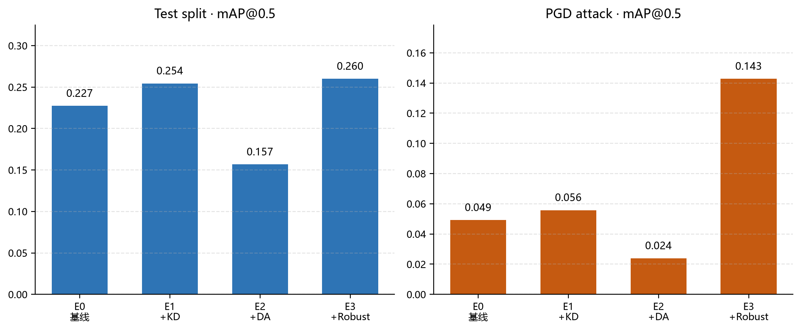
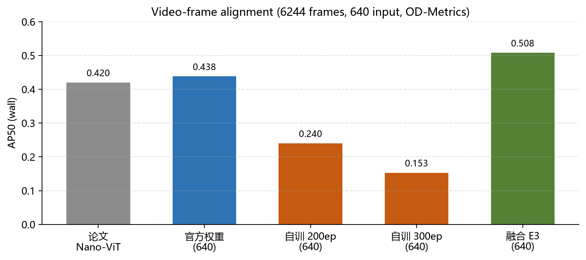

# 侧扫声呐图像目标检测 · 三篇开源论文融合复现

**Fused reproduction of KD-YOLOX-ViT + DCBD + ROSAR for side-scan sonar object detection**

[](LICENSE)
[](https://www.python.org/)
[](https://pytorch.org/)
[]()
[](https://zenodo.org/records/10528135)

> 个人复现 / 学习项目，**不是**任何论文的官方实现。基座代码来自
> [remaro-network/KD-YOLOX-ViT](https://github.com/remaro-network/KD-YOLOX-ViT)（Apache-2.0），上游原始 README 见 [`README_upstream.md`](README_upstream.md)。

本项目将三篇开源工作的方法思路融合成**一个检测器**，在同一套评测协议下做逐级消融：

- **P1 KD-YOLOX-ViT**：轻量检测器 YOLOX-Nano-ViT + 教师-学生知识蒸馏
- **P2 DCBD**：无监督域自适应 / 伪标签自训练，缓解侧扫声呐标注少的问题
- **P3 ROSAR**：PGD 对抗样本 + 对抗重训练，提升噪声与攻击下的鲁棒性

训练链：**E0 基线 → E1 +KD → E2 +域自适应 → E3 +对抗重训练（最终）**。

---

## 🔑 主要结果

### test split（130 张，416 输入，COCO 指标）

| 模型 | mAP@0.5 | mAP@0.5:0.95 | Recall@0.5 | BestF1 P / R |
|---|---|---|---|---|
| E0 基线 | 0.2273 | 0.1187 | 0.7460 | 0.222 / 0.601 |
| E1 + KD | 0.2544 | 0.1431 | 0.8606 | 0.236 / 0.697 |
| E2 + DA | 0.1567 | 0.0702 | 0.8591 | 0.154 / 0.775 |
| **E3 + 对抗（最终）** | **0.2600** | **0.1537** | 0.8584 | 0.218 / 0.615 |



### 视频帧对齐（6244 帧，640 输入，论文同款 OD-Metrics）

| 模型 | AP50（wall） |
|---|---|
| 论文 Nano-ViT | 0.42 |
| 官方 Nano-ViT 权重（640） | **0.438** |
| 自训 Nano-ViT 200ep / 300ep | 0.240 / 0.153 |
| **融合模型 E3（640）** | **0.508** |



**结论**：评测协议可以对齐（官方权重 0.438 vs 论文 0.42）；训练侧因论文配置未完整公开，无法逐位复刻；融合模型在同协议下最优。

### 推理复杂度（RTX 4060，交替 4 轮取最小）

| 模型 | 结构 | 参数量 | 延迟 | mAP@0.5 |
|---|---|---|---|---|
| E0 | YOLOX-Nano-ViT | 1.39 M | 34.65 ms | 0.2273 |
| E3 | YOLOX-Nano-ViT | 1.39 M | 33.98 ms | **0.2600** |

→ 同结构、同参数量、同速度：精度提升来自训练策略，而非推理复杂度。

---

## 📦 预训练权重

权重体积较大，放在 **GitHub Releases**：[Releases](https://github.com/xxh666umr/side-scan-sonar-detection-fusion-repro/releases)

| 文件 | 说明 |
|---|---|
| `swdd-nano.pth` / `swdd-nano-ViT.pth` | 论文官方权重（用于复现原文与 E0 底座） |
| `e1_kd_best_ckpt.pth` | E1（+KD） |
| `e2_da_best_ckpt.pth` | E2（+域自适应） |
| `e3_final_best_ckpt.pth` | E3（+对抗重训练，最终模型） |
| `swdd-L.pth` / `swdd-L-ViT.pth` | 论文官方大模型权重（可选，体积大） |
| `yolox_nano_coco.pth` | YOLOX-Nano COCO 预训练权重（训练初始化用，可选） |

`SHA256SUMS.txt` 随 Release 一同提供。

---

## 🚀 快速开始

```bash
git clone https://github.com/xxh666umr/side-scan-sonar-detection-fusion-repro.git
cd side-scan-sonar-detection-fusion-repro

python -m venv .venv
# Windows: .venv\Scripts\activate   Linux: source .venv/bin/activate
pip install torch==2.5.1 torchvision==0.20.1 --index-url https://download.pytorch.org/whl/cu121
pip install -r requirements_fusion.txt
```

数据（SWDD，CC-BY-4.0，不随仓库分发）：<https://zenodo.org/records/10528135>

```
datasets/COCO/SWDD/
  train2017/  val2017/  test2017/
  annotations/instances_{train,val,test}2017.json
```

评估：

```bash
python tools/fusion_eval.py -f exps/swdd/nano_vit.py \
  -c weights/swdd-nano-ViT.pth \
  --data_dir datasets/COCO/SWDD \
  --ann datasets/COCO/SWDD/annotations/instances_test2017.json \
  --img_dir datasets/COCO/SWDD/test2017 --tsize 416 \
  --out outputs/e3_test.json
```

训练与融合：

```bash
# E0 基线
python tools/train.py -f exps/swdd/nano_vit.py -b 8 --fp16 -expn e0 \
  -o data_num_workers 0 max_epoch 200 no_aug_epochs 10 eval_interval 10

# E1 → E3 一键消融
python run_pipeline.py --e0_ckpt YOLOX_outputs/e0/best_ckpt.pth --epochs 20
```

更多细节见 [`本地运行说明.md`](本地运行说明.md)。

---

## 🗂 目录结构

```
.
├─ exps/swdd/                  # 实验配置（nano / nano_vit / l / l_vit / KD）
├─ tools/
│   ├─ fusion_eval.py          # test split 评估（P/R/mAP）
│   ├─ fusion_predict.py       # 教师/学生伪标签生成
│   ├─ fusion_merge.py         # 多源 COCO 标注合并
│   ├─ fusion_make_target.py   # 模拟域偏移目标域 + 域偏移测试集
│   ├─ fusion_pgd.py           # PGD 对抗样本生成
│   ├─ eval_video_od_metrics.py# 视频帧 OD-Metrics 评估
│   ├─ eval_video_modes.py     # 多预处理/输入尺寸评估（带缓存）
│   ├─ show_video_alignment.py # 对齐结果汇总
│   └─ measure_complexity.py   # 参数量 / 延迟测量
├─ scripts/                    # 数据下载、流水线、转换等辅助脚本
├─ third_party/                # OD-Metrics（MIT，论文同款评测工具）
├─ results/                    # 评测结果（json / md / 图）
├─ docs/                       # 复现报告、PPT、讲稿、答辩速查卡
├─ yolox/                      # YOLOX 基座代码（Apache-2.0，来自上游）
├─ run_pipeline.py             # E0→E1→E2→E3 一键流程
└─ requirements_fusion.txt
```

---

## ⚠️ 复现说明与局限

- 视频帧评测需要 **640 输入 + letterbox**；416 会明显低估（详见 [`results/video_alignment.md`](results/video_alignment.md)）。
- DCBD 与 Faster R-CNN 强耦合，本项目用“伪标签自训练”做了**方法迁移**，并非逐行复现。
- 论文训练配置未完整公开：自训 200/300 轮 AP50 为 0.240/0.153，低于官方 0.438。
- 域偏移测试集为人工模拟（噪声/模糊/黑线/光照），不是真实组内数据。
- 单卡 8GB 环境，未做多种子重复实验。

## 📝 引用

```bibtex
@misc{xia2026sonarfusion,
  author = {Xia, Xinhao},
  title  = {Fused reproduction of KD-YOLOX-ViT + DCBD + ROSAR for side-scan sonar object detection},
  year   = {2026},
  url    = {https://github.com/xxh666umr/side-scan-sonar-detection-fusion-repro}
}
```

原始论文：

1. Aubard et al. *Knowledge Distillation in YOLOX-ViT for Side-Scan Sonar Object Detection*. arXiv:2403.09313, 2024.
2. Wei et al. *Unsupervised underwater shipwreck detection in side-scan sonar images based on domain-adaptive techniques*. Scientific Reports 14:12687, 2024. DOI: 10.1038/s41598-024-63501-1.
3. Aubard et al. *ROSAR: An Adversarial Re-Training Framework for Robust Side-Scan Sonar Object Detection*. arXiv:2410.10554, 2024.

## 📄 许可与致谢

- 基座代码：[remaro-network/KD-YOLOX-ViT](https://github.com/remaro-network/KD-YOLOX-ViT)，Apache-2.0，详见 [`LICENSE`](LICENSE) 与 [`NOTICE`](NOTICE)。
- 数据集 SWDD：CC-BY-4.0，由 OceanScan-MST 在 H2020 REMARO 项目下采集；再发布时请保留其版权声明（见 `NOTICE`）。
- 评测工具：[rafaelpadilla/Object-Detection-Metrics](https://github.com/rafaelpadilla/Object-Detection-Metrics)，MIT，见 `third_party/`。

> **免责声明**：本项目为个人学习 / 复现用途，实验结果与论文原始数值不可直接比较（评测协议不同），详见 `results/`。
